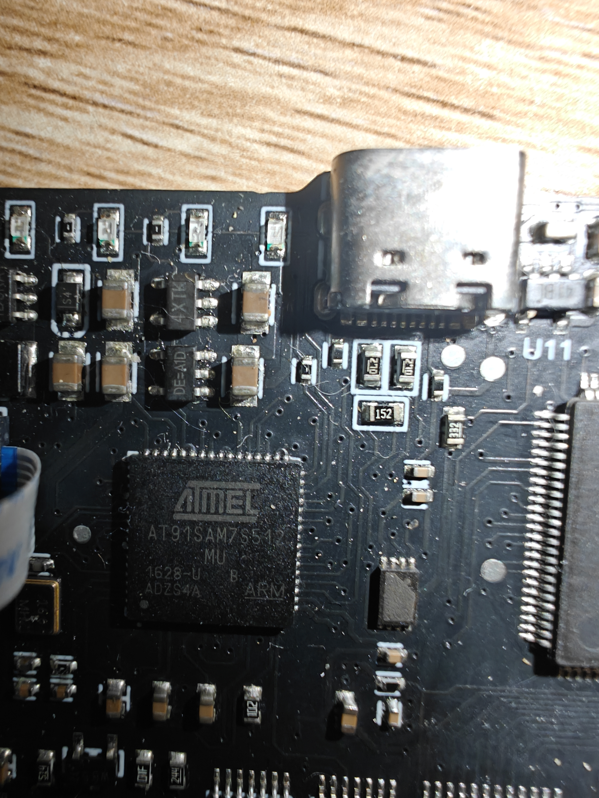
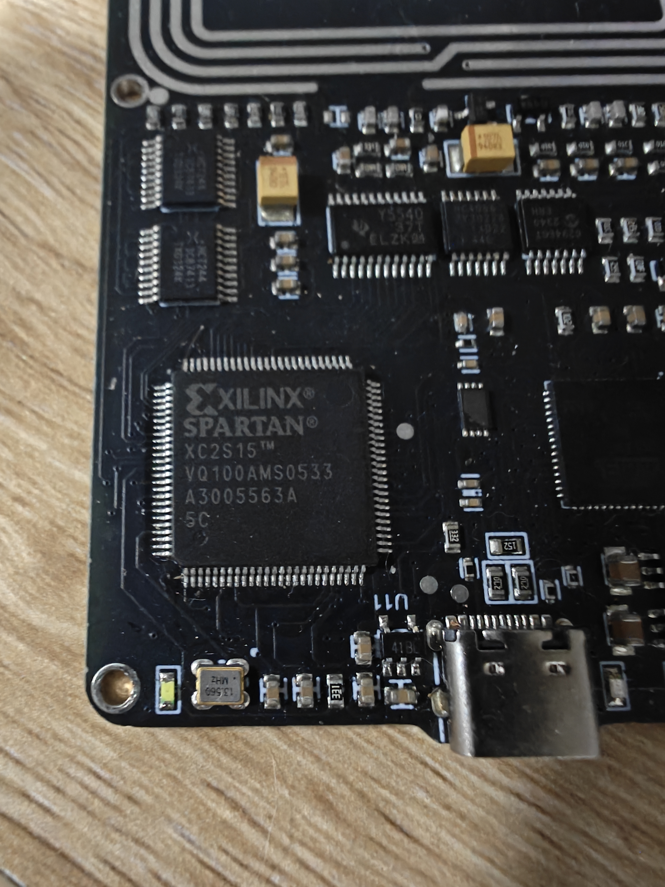

# PM3Max-OpenFW

**Proxmark3 Max 的开源社区固件** — 基于 [RRG/Iceman proxmark3](https://github.com/RfidResearchGroup/proxmark3) **v4.23346 "Frosty Lemon"**（2026-09-18 发布的最新正式版）移植，适配 PM3 Max 硬件（AT91SAM7S512 + XC3S100E FPGA）。

厂商自带的固件停留在 2024 年的 v4.20728 时代且源码闭源，本项目把整个移植过程、补丁、预编译 FPGA 镜像和刷机工具全部公开，任何人都可以自行编译、验证和改进。

> **配套手机 App：[ProxPocket](https://github.com/zzqsld/ProxPocket)** —— 在 Android 手机上通过 USB OTG 驱动 PM3 Max 的开源客户端，内置与本固件同源的 RRG v4.23346 完整核心：Mifare 一键智能解析（含三代 SEN 攻击）、低频读写、CPU/公交卡、Ultralight/ISO15693、完整终端。刷上本固件后手机装个 APK 即可出门读卡，无需电脑。

---

## 目录

- [配套 App：ProxPocket](#配套-appproxpocket)
- [特性与改进](#特性与改进)

- [特性与改进](#特性与改进)
- [硬件分析](#硬件分析)
- [兼容性矩阵](#兼容性矩阵)
- [刷机教程](#刷机教程)
- [救砖](#救砖)
- [自行编译](#自行编译)
- [FPGA 镜像说明](#fpga-镜像说明)
- [目录结构](#目录结构)
- [致谢与许可](#致谢与许可)
- [免责声明](#免责声明)

---

## 配套 App：ProxPocket

[ProxPocket](https://github.com/zzqsld/ProxPocket) 是与本固件配套的开源 Android 客户端（GPLv3），通过 USB OTG 连接 PM3 Max，把完整的 pm3 客户端搬到手机上：

- 原生核心与本固件同源（RRG v4.23346 编译为 `libpm3rrg_rdv4.so`），版本哈希对齐，无 "ARM firmware does not match" 警告
- 高频 M1 卡一键智能解析（默认密钥 / Nested / Hardnested / 三代 FM11RF08S 静态随机数攻击）、dump 浏览编辑、写 UID/CUID/GDM、锁 UFUID、卡片修复
- 低频读 ID / 写 T5577、CPU 卡与公交卡（余额、交易记录）、DESFire、Ultralight/NTAG、ISO15693
- 完整 pm3 终端，可执行任意客户端命令
- 内置合并密钥字典，免连接可先浏览功能界面

APK 下载见 [ProxPocket Releases](https://github.com/zzqsld/ProxPocket/releases)（Android 8.0+，支持 arm64 / arm32 / x86 / x86_64 四种构建）。

---

## 特性与改进

相比厂商固件（基于 RRG v4.20728，2025-09），本固件升级到 v4.23346，涵盖三个大版本（Permafrost → BREAKMEIFYOUCAN! → Frosty Lemon）的全部更新，摘选对 PM3 Max 用户最有价值的部分：

**MIFARE Classic / 门禁卡**
- `hf mf autopwn` 修复：某个扇区破解失败不再丢弃已恢复的密钥
- `hf mf nested` 修复：卡片 NAK 时正确终止 nonce 收集，不再卡到客户端超时
- `hf mf view` / `hf mf dump` 新增 VIGIK 签名验证、HID PACS 凭证解码、Urmet Captiv / Hexact 卡片字段解析
- `hf mf keygen` 新增 Snapmaker U1 耗材 KDF

**DESFire（本版本重头戏）**
- 全新 `hf mfdes sim`：完整的 DESFire EV1 卡模拟（认证、安全信道、文件读写、创建/删除应用和文件、FormatPICC 等）
- 新增 `hf mfdes dump`（整卡遍历导出 JSON）、`hf mfdes view`、`hf mfdes eload/esave/eview`
- `hf mfdes detect/chk` 大幅优化（扫描认证次数从 99 次降到 63 次）

**Ultralight / NTAG**
- 全面支持 Ultralight AES 认证与安全消息（info/rdbl/wrbl/dump/wipe/setkey）
- 新增 mfulc_counterfeit_recovery、ntag22x_suncmac_recovery 等恢复脚本

**iCLASS / SEOS**
- `hf iclass legbrute` 性能大幅优化（LUT + 多线程修复 + ETA 显示）
- 新增 `hf iclass tagsim`、`hf iclass lookup --live`、`hf iclass blacktears`、`hf secc` 系列命令

**设备稳定性（对 Max 尤其重要）**
- `lf read` 实时读取修复：主机处理变慢时不再提前结束、不再静默死机需要重新拔插
- USB 协议栈多个修复（STALL 等待有界、WCID 描述符、CDC line coding）
- NG 回包字对齐优化，USB 传输速度 630 → 789 kB/s
- 模拟器内存从 4096 提升到 **8192 字节**
- 修复 FPGA bitstream 下载破坏模拟器内存的问题

完整变更见 [source/CHANGELOG.md](source/CHANGELOG.md)。

---

## 硬件分析

PM3 Max 与 RDV2 / RDV4 的关键差异：

| | RDV2 | RDV4 | **PM3 Max** |
|---|---|---|---|
| MCU | AT91SAM7S256/512 | AT91SAM7S512 | AT91SAM7S512 |
| FPGA | Spartan-2 XC2S30 | Spartan-2 XC2S30 | **Spartan-3E XC3S100E** |
| FPGA 镜像 | HF/LF 分开加载 | HF/LF 分开加载 | **单张合并镜像**，GPIO 动态切换 |
| 外部 Flash | 无 | 256KB | 512KB (W25X40BV) |
| 智能卡槽 | 无 | 有 | 有 |
| FPC 扩展 | 无 | 蓝牙扩展 | 蓝牙扩展 + 开发者串口 |

芯片实拍（FPGA 丝印被打磨重标为 "XC2S15"，实际硅片为 XC3S100E，详见[硬件文档](hardware/README.md)）：

| MCU (AT91SAM7S512) | FPGA (重标的 XC3S100E) |
|---|---|
|  |  |

GPIO 引脚映射、FPGA bitstream 逆向细节等完整内容见 **[hardware/README.md](hardware/README.md)**。

---

## 兼容性矩阵

PM3 的客户端与固件通过 capabilities 版本号握手，**必须严格匹配**：

| 固件 | caps 版本 | 可用客户端 |
|---|---|---|
| 厂商固件 / 本项目 v4.20728 | v6 | 厂商 PC 客户端、ProxPocket 旧版 App |
| **本项目 v4.23346（推荐）** | v11 | [RRG v4.23346 官方客户端](https://github.com/RfidResearchGroup/proxmark3/releases)、ProxPocket 新版 App |
| RRG master 每日构建 | v13 | 仅匹配 master 固件，**不能**连本固件 |

> ⚠️ 刷入 v4.23346 后，**厂商 2024 年的 PC 客户端将永远连不上设备**（这是单向的协议升级）。想恢复请刷回 v4.20728 或厂商固件。

---

## 刷机教程

### 准备

1. 下载 Release 包并解压
2. 准备一个匹配版本的 PM3 客户端（`proxmark3.exe`），放到解压目录下的 `client\` 文件夹（与 `flash\` 平级），或加入系统 PATH
   - 刷 v4.23346：用 [RRG v4.23346 发布版](https://github.com/RfidResearchGroup/proxmark3/releases)
   - 刷 v4.20728：用厂商客户端或 RRG v4.20728

### 刷入

1. 设备用 USB 线连接电脑：
   - 设备当前是**厂商固件或 v4.20728**：直接插入即可
   - 设备当前已经是 **v4.23346 或更新**：**按住侧面按键**插入 USB 线，保持按住直到刷机开始
2. 打开设备管理器查看端口号（端口 → COMx）
3. 运行 `flash\` 目录下对应脚本，**按提示手动输入端口号**（如 COM8 就输入 `8`）：

| 脚本 | 作用 |
|---|---|
| `flash_v4.23346.bat` | 刷入最新 v4.23346 固件（推荐） |
| `flash_v4.20728.bat` | 刷回 v4.20728（恢复厂商客户端兼容） |
| `restore_vendor_firmware.bat` | 恢复厂商官方固件（需自行提供厂商 `fullimage.elf`，重命名为 `firmware\vendor_fullimage.elf`） |

4. 刷完拔线重新插入（不要按按键），连接客户端运行 `hw version` 验证：

```
 [ ARM ]
  Bootrom.... github.com/rfidreadermaker/proxmark3-max-suspect ...
  OS......... Iceman/master/v4.23346-suspect ...
```

> Bootrom 始终是厂商原厂的，本项目不改动 bootrom；`hw version` 中 `FPGA firmware... chip mismatch` 为显示问题，不影响功能。

### 救砖

任何时候刷机失败/变砖：**按住侧面按键插入 USB 线** → 设备进入厂商 bootrom 刷机模式（枚举为串口）→ 重新运行刷机脚本即可。bootrom 不会被刷写，因此设备永远可救。

---

## 自行编译

### 环境（Windows）

1. ARM 工具链：[Arm GNU Toolchain 13.2.Rel1](https://developer.arm.com/downloads/-/arm-gnu-toolchain-downloads)（`arm-none-eabi`，mingw-w64-i686 版）
2. GNU make（可用 Android NDK 自带的 `prebuilt/windows-x86_64/bin/make.exe`，或 ProxSpace 环境）
3. Python 3（需要 `lz4` 模块：`pip install lz4`）

### 步骤

```bash
# 方式一：直接使用本仓库已打补丁的源码
cd source

# 方式二：从上游干净克隆 + 打补丁
# git clone https://github.com/RfidResearchGroup/proxmark3.git -b v4.23346 --depth 1
# cd proxmark3 && git apply ../patches/pm3max_v4.23346.patch
# cp -r ../prebuilt/* armsrc/prebuilt/  (见下)
# cp ../prebuilt/Makefile.platform .

# 准备 fpga_compress（make clean 会删除它，每次 clean 后要重新复制）
cp ../tools/fpga_compress tools/fpga_compress/fpga_compress
chmod +x tools/fpga_compress/fpga_compress

# 编译（PATH 指向 ARM 工具链）
export PATH="/d/path/to/arm-gnu-toolchain/bin:$PATH"
make -C armsrc all

# 产物：armsrc/obj/fullimage.elf
```

### 移植补丁内容（共 4 处）

| 文件 | 改动 |
|---|---|
| `common_arm/Makefile.hal` | 新增 `PM3PMAX` 平台：`-DWITH_FLASH -DWITH_SMARTCARD -DWITH_FPC_USART_HOST -DWITH_FPC_USART_DEV -DXC3`，`PLATFORM_FPGA = xc3s100e` |
| `armsrc/Makefile` | FPGA 版本信息与 bitstream 改为从 `armsrc/prebuilt/` 复制预编译文件 |
| `common_arm/fpga/fpga_loader.c` | FPGA 解压循环增加越界保护（非法块直接报错，不再死循环） |
| `armsrc/lfsampling.c` | `ReadLF_realtime` 增加 SSC 饥饿守卫：500 万次循环无数据则报错退出，防止低频读取永久挂死 |

另有平台配置文件 `Makefile.platform`（内容为 `PLATFORM=PM3PMAX`）和 `armsrc/prebuilt/`（FPGA 镜像），二者被上游 `.gitignore` 忽略，已备份在本仓库 `prebuilt/` 目录。

---

## FPGA 镜像说明

厂商**不公开 FPGA 源码**（`fpga_pmimax_hf.ncd`，Xilinx ISE 编译）。本仓库的 bitstream 提取自厂商发布的 `fullimage.elf`（偏移 `0x41cc6` 处的 LZ4 压缩流），仅作二进制复用：

- 原始流：3 个 30KB 块，压缩 26,587 字节，解压 72,749 字节（`.bit` 数据段 72,668 字节，与 XC3S100E 配置空间精确吻合）
- v4.23346 将 FPGA 接收缓冲区从 30KB 缩小到 16KB，因此提供重新分块的版本：

| 文件 | 块大小 | 用途 |
|---|---|---|
| `prebuilt/fpga_all.bit.z` | 16KB × 5 块 | v4.23346 固件 |
| `prebuilt/fpga_all_30k.bit.z` | 30KB × 3 块 | v4.20728 及更早固件 |

**混用会导致 FPGA 加载失败（红灯、读卡超时）**，编译哪个版本就用对应的文件。

---

## 目录结构

```
pm3max-openfw/
├── README.md                ← 本文件
├── LICENSE.txt              ← GPLv3（继承自 RRG proxmark3）
├── source/                  ← v4.23346 + PM3PMAX 补丁的完整源码，可直接编译
├── patches/                 ← 移植补丁（打在干净上游源码上）
├── prebuilt/                ← FPGA bitstream、版本信息、Makefile.platform
├── tools/
│   └── fpga_compress        ← Python 版 FPGA 压缩工具（支持 -s 单块模式）
├── firmware/                ← 编译好的固件（release 用）
│   ├── fullimage_v4.23346_pm3max.elf
│   └── fullimage_v4.20728_pm3max.elf
├── flash/                   ← Windows 刷机脚本（手动输入端口）
└── hardware/                ← 硬件分析文档 + 芯片实拍
```

---

## 致谢与许可

- 固件主体：[RRG/Iceman proxmark3](https://github.com/RfidResearchGroup/proxmark3)，GPLv3，本仓库源码沿用 [LICENSE.txt](LICENSE.txt)
- FPGA bitstream：版权属于 PM3 Max 硬件厂商（rfidreadermaker），提取自其官方固件，仅供学习研究和设备维护使用
- 硬件 GPIO 定义参考上游 iCopy-X（PM3ICOPYX）平台
- 移植与适配：ProxPocket 项目

---

## 免责声明

本固件为社区实验性项目，与硬件厂商无关。刷机有风险，操作前请确认已掌握救砖方法（按住按键插线进 bootrom）。请遵守所在地区的法律法规，仅对自己拥有的卡片和设备进行测试。使用本固件造成的一切后果由使用者自行承担。

---

## English Summary

**PM3Max-OpenFW** is a community open-source firmware for the Proxmark3 Max (AT91SAM7S512 + re-marked XC3S100E FPGA), ported from RRG/Iceman proxmark3 **v4.23346 "Frosty Lemon"**.

- The vendor ships a 2024-era closed-source firmware; this project documents and publishes the full port: 4 source patches (`patches/`), the FPGA bitstream extracted from the vendor image (`prebuilt/`), build tooling, flashing scripts and hardware analysis (`hardware/`).
- The Max replaces the classic XC2S30 with an XC3S100E running a **single combined HF+LF bitstream**, switched at runtime via GPIO PA26. The bitstream had to be re-sliced into 16KB LZ4 blocks for v4.23346's smaller ring buffer.
- Flashing: hold the side button while plugging in to enter the vendor bootrom (unbrickable), then run the manual-port scripts in `flash/`. Client and firmware caps versions must match (v4.23346 = caps v11; vendor client won't connect anymore).
- Firmware code is GPLv3 (inherited from RRG). The FPGA bitstream remains the hardware vendor's property and is redistributed for interoperability/repair purposes only.
