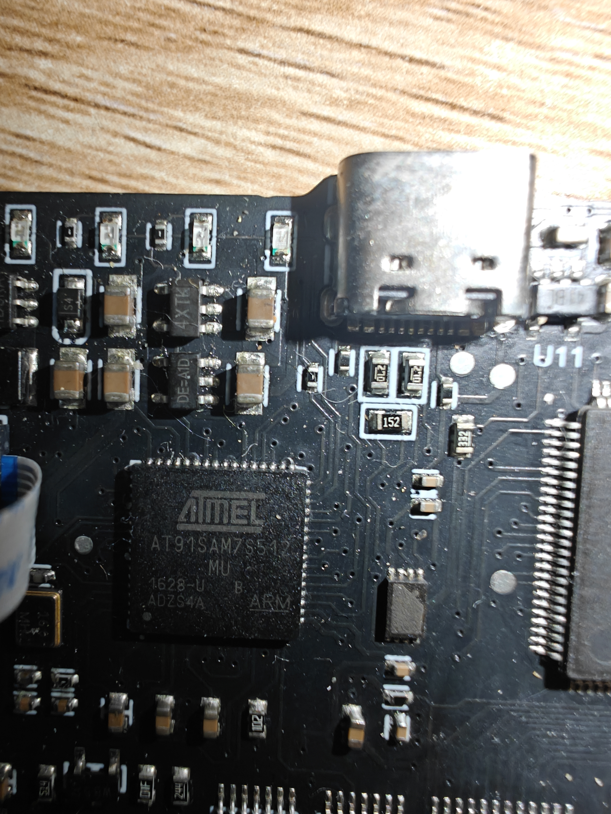
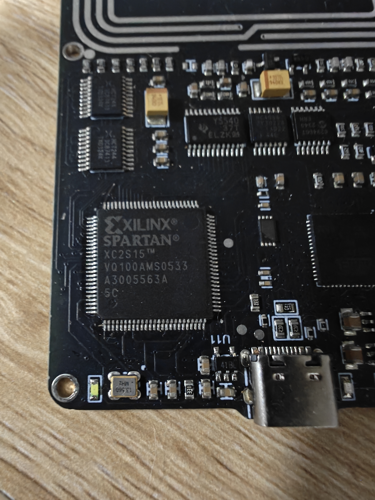

# PM3 Max 硬件分析

本文档记录对 PM3 Max 读卡器的硬件逆向分析结果，所有结论均经过实物照片、厂商固件逆向和上游源码交叉验证。

## 芯片清单

| 部件 | 型号 | 说明 |
|---|---|---|
| 主控 MCU | Atmel **AT91SAM7S512** (Rev B) | ARM7TDMI，64KB SRAM，512KB 内部 Flash。与 RDV4 相同 |
| FPGA | Xilinx Spartan-3E **XC3S100E** (VQ100) | **丝印被打磨重标为 "XC2S15"**，见下文分析 |
| 外部 Flash | Winbond **W25X40BV** | 512KB SPI Flash（JEDEC ID EF/3013），存储密钥字典、T55XX 配置 |
| 智能卡接口 | ISO 7816 SIM 卡槽 | 固件报告 v4.42 模块 |
| 扩展接口 | FPC 排座 | 两路 USART：蓝牙扩展 + 开发者调试 |

实拍照片：

|  |  |
|---|---|
| AT91SAM7S512 主控 | 重标丝印的 FPGA |

## FPGA 真实型号判定

芯片表面丝印为 "XILINX SPARTAN XC2S15 VQ100AMS0533"，但这是打磨后重新激光打标的假丝印。实际判定依据：

1. 从厂商固件提取的 FPGA bitstream 解压后为 **72,749 字节**，其中 `.bit` 配置数据段 **72,668 字节** —— 与 XC3S100E 的配置空间精确吻合（XC2S15 的配置空间远小于此）
2. 厂商固件版本字符串自述：`fpga_pmimax_hf.ncd image 2s300avq100`（NCD 为 Xilinx ISE 的网表文件）
3. 上游 XC3 平台（iCopy-X）的加载代码在该硬件上**直接工作**，HF/LF 读卡全部正常

## GPIO 引脚映射

与上游 iCopy-X（PM3ICOPYX）平台完全一致（`include/config_gpio_proxmark3.h`）：

| 引脚 | 功能 | 说明 |
|---|---|---|
| PA4 | FPGA_NINIT | FPGA 初始化状态 |
| PA13 (MOSI) | 模式脚 | 加载 FPGA 时复用为配置模式 |
| PA14 (SPCK) | 模式脚 | 同上 |
| **PA26** | **HF/LF 切换** | 运行时切换高频/低频逻辑（Max 特有，免重烧镜像） |
| PA27 | FPGA_DONE | 配置完成指示 |
| PA28 | FPGA_NPROGRAM | 配置启动 |
| PA29 | FPGA_CCLK | 配置时钟 |
| PA30 | FPGA_DIN | 配置数据输入 |
| PA31 | FPGA_DOUT | 配置数据回读 |

LED 顺序与 PM3GENERIC 相同（4 个用户 LED）。

## 与 RDV2 / RDV4 的架构差异

| | RDV2 | RDV4 | PM3 Max |
|---|---|---|---|
| MCU | AT91SAM7S256/512 | AT91SAM7S512 | AT91SAM7S512 |
| FPGA | XC2S30 (Spartan-2) | XC2S30 (Spartan-2) | **XC3S100E (Spartan-3E)** |
| FPGA 镜像 | HF/LF 两张分开加载 | HF/LF 两张分开加载 | **单张合并镜像**，PA26 动态切换 |
| 切换协议开销 | 每次重新下载 bitstream | 每次重新下载 bitstream | 仅翻转 GPIO |
| 外部 Flash | 无 | 有 | 512KB W25X40BV |
| 智能卡槽 | 无 | 有 | 有 |
| FPC 扩展 | 无 | 蓝牙 | 蓝牙 + 开发者串口 |

**结论：PM3 Max ≈ RDV4 的周边配置 + iCopy-X 的 FPGA 方案 + 厂商自绘的 HF/LF 合并镜像。**

## FPGA bitstream 逆向

厂商不公开 FPGA 源码（Xilinx ISE 工程 `fpga_pmimax_hf.ncd`，2024-02-03 编译）。bitstream 以 LZ4 压缩流的形式嵌在厂商 `fullimage.elf` 中：

- 位置：`fullimage.elf` 偏移 `0x41cc6`
- 原始格式：3 个独立 LZ4 块，每块对应 30KB 解压窗口（匹配旧版固件 `FPGA_RING_BUFFER_BYTES = 30720`）
- 压缩 26,587 字节 → 解压 72,749 字节
- 开头含可打印的镜像描述字符串（即 `hw version` 中显示的 FPGA 信息）

### v4.23346 的 16KB 分块问题

RRG v4.23346 为了把模拟器内存从 4KB 提升到 8KB，将 `FPGA_RING_BUFFER_BYTES` 从 30KB 缩小到 **16KB**。直接把 30KB 块大小的旧流喂给新固件会导致解压溢出（表现为红灯常亮、读卡超时）。

解决方法：将原始流完整解压后，用 `tools/fpga_compress` 重新按 16KB 独立块压缩（5 块，27,303 字节）。每个块独立可解压，固件按块循环解压拼接。

### 提取与重打包方法

```python
# 1. 从厂商 fullimage.elf 提取（偏移可能随厂商版本变化）
#    找到 LZ4 流起始（描述字符串前的长度头），按块解压
# 2. 解压后得到原始 bitstream（含 .bit 头）
# 3. 用 tools/fpga_compress 重新打包：
python tools/fpga_compress 1728 fpga_all.bit   # 块大小由固件版本决定
```

`fpga_compress` 的参数为 FPGA 环形缓冲区减去头部开销后的值，v4.23346 用 16KB 档，v4.20728 及更早用 30KB 档。

## 启动与刷机模式

- **bootrom 为厂商原厂**，本项目不修改、不重新刷写 bootrom
- 正常模式：直接插线，枚举为 USB CDC 串口
- 刷机模式：**按住侧面按键插线**，进入厂商 bootrom，接受 `--flash` 刷写
- 因为 bootrom 不动，设备永远可以通过按住按键救砖
